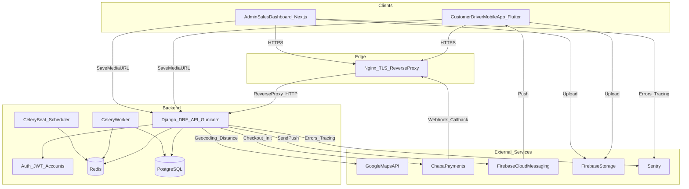
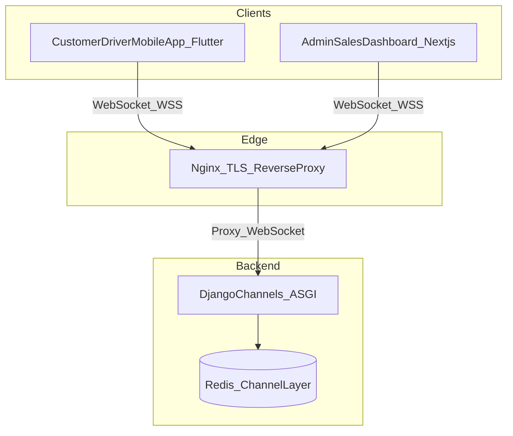

# System Architecture

This document defines the **high-level platform architecture** for the Kech Delivery App MVP, based on the MVP scope in `README.md`.

## Architecture Layers (MVP)

- **Mobile App (Flutter)**: Shared binary with role selection at login (Customer / Driver)
- **Web Dashboards (Next.js)**: Admin dashboard + Sales dashboard
- **Backend API (Django + DRF)**: Single backend deployment, organized as Django apps (not microservices)
- **Database (PostgreSQL)**: Primary system of record

## External Services (MVP)

- **Google Maps API**: geocoding + distance computation for delivery pricing and routing context
- **Chapa Payment Gateway**: online payment checkout + webhook verification
- **Firebase Cloud Messaging (FCM)**: push notifications
- **Firebase Storage**: store uploaded media (restaurant images, menu images, driver documents)
- **Sentry**: error monitoring for backend and dashboards (MVP minimum)

## High-Level Architecture Diagram

## Stage 2: WebSockets / Realtime (Django Channels)

Realtime is deferred beyond MVP, but the intended architecture is:

## Communication Patterns

- **Mobile/Web → Backend**: HTTPS REST API (DRF) using JWT auth.
- **Backend async**: Celery tasks via Redis (notifications, webhook post-processing, rollups).
- **Realtime (Phase 2+)**: Django Channels via Redis for live updates. For MVP, keep realtime optional; rely on polling + push.

## Startup Scaling Strategy

### Stage 1 — MVP (Single VPS)
- Nginx (TLS + reverse proxy)
- Django DRF API (Gunicorn)
- PostgreSQL
- Redis (Celery broker/cache; optional channels layer kept disabled)
- Celery Worker + Celery Beat
- External services: Google Maps, Chapa, FCM, Firebase Storage

### Stage 2 — Growing Users (Split Servers)
- **Server 1 (API)**: Nginx + Django DRF + optional Channels (ASGI)
- **Server 2 (Workers)**: Celery Workers + Celery Beat + Redis
- **Server 3 (DB)**: PostgreSQL
- Enable **WebSockets** for live order updates and driver request dispatch (Channels).

### Stage 3 — Large Scale
- Load balancer + multiple API instances
- Separate ASGI/Channels tier if needed
- Redis cluster, CDN for dashboard assets, stronger observability and alerting

## Operational Improvements (Recommended)

### Rate limiting
- **At Nginx**: basic request limiting per IP for abusive traffic.
- **At Django/DRF**: DRF throttling or `django-ratelimit` for auth endpoints and order creation.

### API documentation
- Use **`drf-spectacular`** to generate OpenAPI schema and Swagger UI for Admin/Sales integration and developer docs.

### Health checks
- Add endpoints:
  - `GET /health` (liveness: process up)
  - `GET /ready` (readiness: DB + Redis reachable)

### Monitoring and logging
- **Sentry** (MVP minimum): capture backend exceptions, dashboard frontend errors, and performance traces.
- Future: Prometheus/Grafana for metrics, centralized log shipping.

### CORS configuration
- Use **`django-cors-headers`** and configure **`CORS_ALLOWED_ORIGINS`** (or `CORS_ORIGIN_WHITELIST`) to explicitly whitelist your Next.js dashboard domains.
- Avoid `*` wildcards in production; whitelist only trusted origins (e.g., Admin/Sales dashboard hosts).
- Ensure `CorsMiddleware` is enabled early in `MIDDLEWARE` (above common middleware that may generate responses).

### Backup and disaster recovery
- Automate **daily PostgreSQL backups**, and enable **WAL archiving / PITR (point-in-time recovery)** for production.
- Store backups **offsite** (separate volume/bucket) and define a retention policy (e.g., 7–30 daily snapshots + longer-term monthly).
- Perform regular **restore drills** to verify backups are actually usable.
- Common tooling options:
  - `pgbackrest` (recommended for PITR)
  - `pg_dump` (logical backups)
  - continuous WAL archive for recovery windows

## Core Data Ownership (PostgreSQL)

- Users and role claims
- Driver verification status + documents metadata
- Restaurants, menus, availability, opening hours
- Orders, order items (snapshots), delivery events
- Payments ledger + webhook logs
- Operational configs (pricing, wait time, cancellation rules)
- Analytics rollups (simple aggregates)

## Security Boundaries

- Enforce **role-based access** at DRF layer (not only UI).
- Verify **Chapa webhooks** server-side before marking payments confirmed.
- Use **direct client uploads** to Firebase Storage (recommended) with strict bucket rules or signed uploads; backend stores URLs and metadata.

