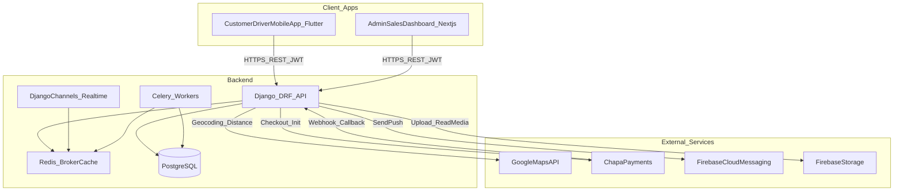

# System Architecture (Day 2)

This document defines the **high-level platform architecture** for the Kech Delivery App MVP, based on the MVP scope in `README.md`.

## Architecture Layers (MVP)

- **Mobile App (Flutter)**: Shared binary with role selection at login (Customer / Driver)
- **Web Dashboards (Next.js)**: Admin dashboard + Sales dashboard
- **Backend API (Django + DRF)**: Single backend deployment, organized as Django apps (not microservices)
- **Database (PostgreSQL)**: Primary system of record

## External Services (MVP)

- **Google Maps API**: geocoding + distance computation for delivery pricing and routing context
- **Chapa Payment Gateway**: online payment checkout + webhook verification
- **Firebase Cloud Messaging (FCM)**: push notifications
- **Firebase Storage**: store uploaded media (restaurant images, menu images, driver documents)

## High-Level Architecture Diagram

## Communication Patterns

- **Mobile/Web → Backend**: HTTPS REST API (DRF) using JWT auth.
- **Backend async**: Celery tasks via Redis (notifications, webhook post-processing, rollups).
- **Realtime (Phase 2+)**: Django Channels via Redis for live updates. For MVP, keep realtime optional; rely on polling + push.

## Core Data Ownership (PostgreSQL)

- Users and role claims
- Driver verification status + documents metadata
- Restaurants, menus, availability, opening hours
- Orders, order items (snapshots), delivery events
- Payments ledger + webhook logs
- Operational configs (pricing, wait time, cancellation rules)
- Analytics rollups (simple aggregates)

## Security Boundaries

- Enforce **role-based access** at DRF layer (not only UI).
- Verify **Chapa webhooks** server-side before marking payments confirmed.
- Use backend-controlled uploads or signed URLs for Firebase Storage.

