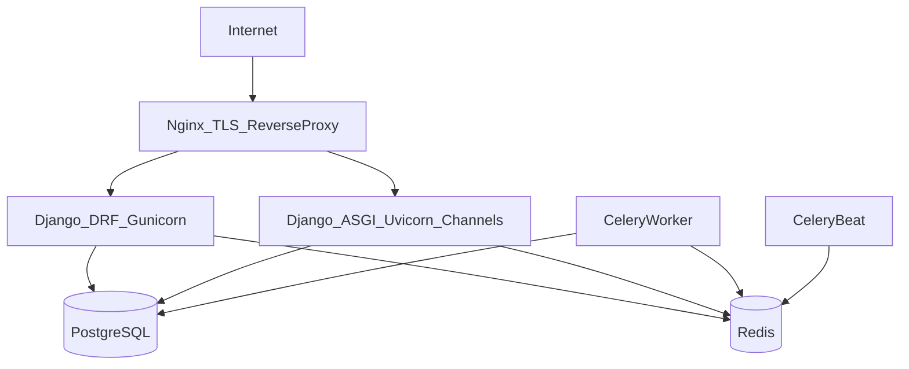

# Deployment Architecture (Yegara VPS) — Day 2

This document describes an MVP deployment architecture on a **single Yegara VPS**.

## Topology (MVP)

Notes:
- If realtime is deferred, you can initially deploy only Gunicorn and keep ASGI off.
- Redis supports Celery + (future) Channels layer.

## Deployment approach

### Recommended: Docker Compose on VPS
- Services: `nginx`, `api`, `asgi` (optional), `worker`, `beat`, `postgres`, `redis`
- Benefits: predictable installs, easy upgrades, consistent dev/prod parity.

### Alternative: systemd services (no Docker)
- Run gunicorn/uvicorn/celery as systemd units.
- Higher ops overhead; more manual configuration.

## Public endpoints
- `443/HTTPS`: Nginx terminates TLS and proxies to Django services.
- Chapa webhook endpoint must be publicly reachable.

## Static and media strategy
- Django static files served via Nginx (`collectstatic`).
- Media stored in **Firebase Storage** (preferred) to avoid VPS disk pressure.

## Future scaling (Phase 2+)
- Separate Postgres/Redis to managed services or separate nodes
- Add CDN for dashboard assets
- Add observability (Sentry, metrics/log shipping)

